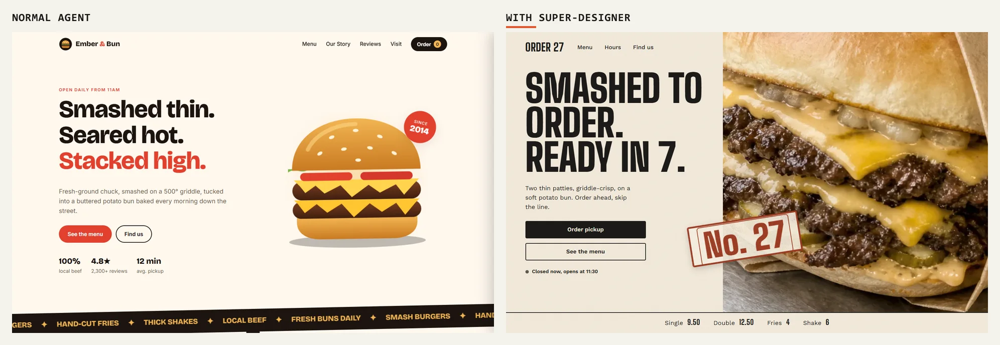
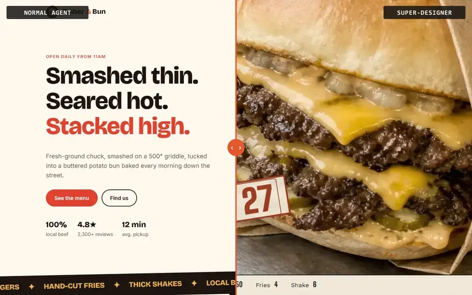

# Super-Webdesigner

**Same prompt. Different designer.**

Coding agents design the same page for everyone: centered hero, three cards,
purple gradient, emoji in the copy. Super-Webdesigner is a pair of skills that
change *how* your agent designs: it researches the niche, shows you three
directions, waits for your choice, and only then writes code. Then it checks
the result against the tells of an AI-made page.

Both sites below came from the same one-line prompt:

> Build a website for a burger restaurant.



<p align="center"></p>

**[Drag the slider yourself → super-webdesigner.vercel.app](https://super-webdesigner.vercel.app)**

Nothing was retouched. The normal agent's output is in
[`examples/burger/normal-agent/`](examples/burger/normal-agent), exactly as
it came out. Every step of the other side is in
[`examples/burger/super-webdesigner/`](examples/burger/super-webdesigner).

## What's different

The 10 tells of a page an agent designed alone. Three or more and it reads as
AI-made.

| Tell | Normal agent | Super-Webdesigner |
|---|---|---|
| Purple or blue gradient | no | no |
| Serif title by default | no | no |
| Grid or dots background | no | no |
| Three generic cards | no | no |
| Emoji in the copy | **yes** (every menu item) | no |
| Glow on everything | no | no |
| The usual layout | **yes** | no |
| Generic thin icons | no | no |
| Everything static | no | no |
| Fake 01 / 02 / 03 | no | no |
| Niche clichés (red + yellow, "since 2014", cartoon burger) | **3** | none |
| Score (10 tells only) | **2/10, watch it** | 0/10, self-assessed |

Also found on the normal agent's page, not scored: invented reviews and
stats ("4.8★, 2,300+ reviews"), and horizontal scroll at 1440 and 390 px.
The Super-Webdesigner side was scored by the agent that built it; its owner
found the result unattractive and the motion thin, which is why the main
example is being redone.

The normal agent's page is competent: readable, with a working cart. The
problem isn't quality. It's that it's the page every agent makes for every
burger place.

## How it works

The `super-webdesigner` skill runs a fixed flow. Three stops wait for you;
everything else the agent does on its own.

1. **Discover the tools.** It lists the skills, MCP servers and browser it
   has, maps them to the jobs of the flow, and recommends installs for what's
   missing. It asks before installing anything.
2. **Stop: the brief.** The agent asks *you* 4 questions, with options to
   click: a real-world object the palette comes from, the one feeling of the
   first 3 seconds, two unexpected influences to collide, and what the page
   must never look like. Same message: the tools it found, and the cost of
   the mockups if they spend credits.
3. **Research the niche.** 8 to 15 real sites, split into what visitors
   **expect** (keep) and what everyone **repeats** (avoid).
4. **Three directions.** Gray skeletons (phone and desktop) plus one colored
   mockup each: A at the level of the best in the niche, B breaking its
   convention, C borrowing from outside it. Each one says its logo, favicon
   and motion.
5. **Stop: you choose.** No code before this.
6. **Write the direction down.** Palette, fonts, wildcard element, what to
   keep, what to avoid. The contract for the build.
7. **Build.** Half the effort on the first screen, with the motion the
   direction defined.
8. **Review, then stop: you judge.** The tells on full-page screenshots, a
   design critique, horizontal scroll at 390 and 1440 px, forms, contrast,
   motion. You see it before anything is published. Then it logs the style
   so the next project doesn't repeat it.

The second skill, `ai-slop-check`, is the review alone: point it at any URL
or screenshot and it scores the page against the 10 tells and says what to
change.

## Tools: whatever your agent has

Every step asks for a **job**, not a tool. The skill is written for Claude
Code and lists the equivalent for other agents and a manual fallback in
[`tool-slots.md`](skills/super-webdesigner/references/tool-slots.md):

| Job | Claude Code | Others |
|---|---|---|
| Research real sites | Web search + built-in browser | Playwright MCP, or links you send |
| Gray skeletons | Artifact | A local HTML file |
| Colored mockups | An image MCP (e.g. Magnific, GPT image models) | ChatGPT, or a prompt you paste |
| Components and docs | shadcn, React Bits, Context7 | The same, through MCP |
| Animation | GSAP skills | GSAP skills, Motion docs |
| Design critique | Anthropic's design plugin | The review checklist |

Paid tools get one rule: the agent says what it will cost before generating.

## Install

**Claude Code**

```bash
npx skills add JouberthAlves/super-webdesigner -g -a claude-code
```

Or copy `skills/super-webdesigner` and `skills/ai-slop-check` into
`~/.claude/skills/`. Then ask for a site the way you normally would.

**Codex, OpenCode and others supported by `skills`**

```bash
npx skills add JouberthAlves/super-webdesigner -a codex
```

**Cursor, Copilot, anything without skills:** add a rule
(`.cursor/rules/`, `.github/copilot-instructions.md`, `AGENTS.md`) that says:
"For any website, page or UI request, read `skills/super-webdesigner/SKILL.md`
and follow it, reading the files in `references/` when a step says so."

## Recommended: a vault (Obsidian)

Agents don't remember anything between sessions. The
[`vault/`](vault) folder is a small Obsidian vault that works as your agent's
memory: one file of rules it reads every session, a log of mistakes that
become one-line rules, a log of what you praised, and every style you've
already used, so it never ships the same look twice.

It's plain Markdown, so any agent can read it. Obsidian adds the link graph
and makes editing the rules easy. Copy the folder, open it as a vault, and
open your agent inside it. Setup details in [`vault/README.md`](vault/README.md).
There's an optional Claude Code hook that re-injects the rules after the
context is compacted.

## Repository

```
skills/super-webdesigner/      the flow (SKILL.md + references/)
skills/ai-slop-check/       the standalone audit
vault/                      starter Obsidian vault
examples/burger/            the comparison, step by step
site/                       the page with the drag slider
```

## What was verified, and what wasn't

- Both burger sites were screenshotted in headless Chrome at 1440×900 and at
  390×844 with real mobile emulation. Order 27: no horizontal scroll at
  either size, order flow tested end to end. Details in
  [`review.md`](examples/burger/super-webdesigner/review.md).
- The Super-Webdesigner side was run, step by step, in the Claude Code session
  that wrote the skill. In that run the agent answered the brief questions
  itself, which the skill now forbids.
- A test agent with only the skill on disk
  ([`clean-room-test.md`](examples/clean-room-test.md)) found it, read it and
  stopped before code, and exposed a contradiction around the cost question,
  now fixed. It ran as a subagent, so whether Claude Code *triggers* the skill
  on its own from a one-line prompt is still untested.
- Research for the example hit a corporate proxy that blocked most sites, so
  it relied on web search and published design breakdowns, without asking
  the owner for links first (which the skill now says to do).
- Not run: Lighthouse against a deployed URL, real iOS Safari, a screen
  reader pass.

## Credits

The brief questions, the anti-convergence rules and the conversion equation
are adapted from
[2389-research/landing-page-design](https://github.com/2389-research/landing-page-design)
(MIT). Fonts from Google Fonts (OFL). Order 27 and Ember & Bun are fictional;
Order 27's photos were generated for this demo.

MIT license.
