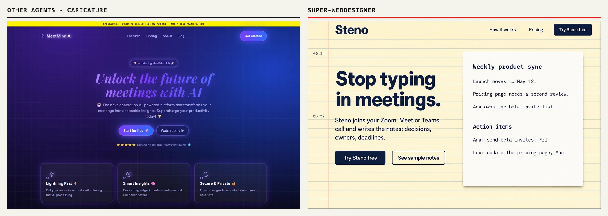
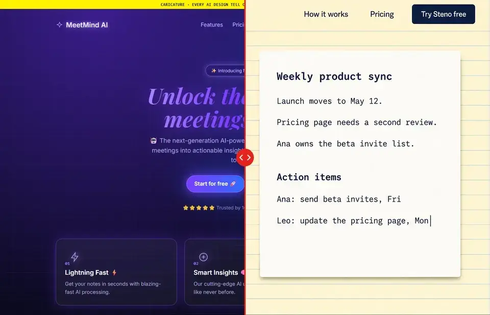

<div align="center">

<br>

<a href="https://super-webdesigner.vercel.app">
  <picture>
    <source media="(prefers-color-scheme: dark)" srcset=".github/readme/logo-dark.png">
    <source media="(prefers-color-scheme: light)" srcset=".github/readme/logo-light.png">
    
  </picture>
</a>

<br><br>

**Same prompt. Different designer.**<br>
Skills that stop coding agents from shipping the same AI-looking page.

<a href="https://super-webdesigner.vercel.app"></a>    <a href="LICENSE"></a>

[Website](https://super-webdesigner.vercel.app) · [See the difference](#see-the-difference) · [The flow](#the-flow) · [Install](#install) · [The vault](#recommended-a-vault)

</div>

---

Your coding agent designs the same page for everyone: a centered hero, three
cards, a purple gradient, emoji in the copy. Super-Webdesigner is two skills
that change how it works. Before any code, the agent asks you a brief,
researches real sites in the niche, and shows you three directions. It waits
for your pick. Then it builds, and checks the result against the 13 tells of
an AI-made page, and that the look still fits the business.

## See the difference

Same prompt in both: *Build a landing page for an AI meeting-notes app.*



<p align="center"></p>

**[Drag the line yourself →](https://super-webdesigner.vercel.app)**

The left side is a **caricature**, built on purpose to show the first ten
tells at once. It is not an agent's real output. The repo has a real one:
[`examples/burger/normal-agent/`](examples/burger/normal-agent) is what a
normal agent produced for a burger place, untouched. It scores 3 of 13 on the
tells (reads as AI-made). The Steno side is fictional and went through the flow end
to end; its files are in [`examples/ai-notes/`](examples/ai-notes).

## The flow

Four stops wait for you. Everything between them the agent does on its own.

| # | Step | You |
|---|---|---|
| 1 | **Discover the tools.** Lists the skills, MCP servers and browser the agent has, and what's missing, with the install command. | |
| 2 | **The brief.** Four questions, with options to click: a real object the palette comes from, one feeling, two influences to collide, what the page must never look like. The cost of any paid mockups comes in the same message. | **Stop: answer** |
| 3 | **Research the niche.** Real sites, split into what visitors expect (kept) and what everyone repeats (avoided). | |
| 4 | **Three directions.** Gray skeletons for phone and desktop, plus a colored mockup each: the best of the niche, one that breaks it, one from outside it. Each has its logo, favicon, motion and visual language (edges, shadows, lines, texture, type), all taken from the business's real world. | |
| 5 | **You choose.** One question: which of the three, or what to mix. | **Stop: choose** |
| 6 | **Write it down.** The direction becomes a file: palette, fonts, the wildcard element, the motion. It is the contract for the build. Then one short block with every decision, your last cheap chance to redirect. | **Stop: ok** |
| 7 | **Build.** The first screen alone first, checked by the lint and by a reviewer that never saw the conversation; then the rest, with the motion the direction asked for. | |
| 8 | **Review.** The lint at five widths, full-page screenshots, the 13 tells, the fit to the business, a fresh-eyes review, a design critique, forms, contrast. | **Stop: judge** |

### After the page exists

Short commands for one job each, without the whole flow: `polish`, `bolder`,
`quieter`, `distill`, `harden`, `clarify`, `adapt` and `lint`, as
`/super-webdesigner polish`. They keep the direction and show before and
after.

### The lint

`skills/super-webdesigner/scripts/sloplint.mjs` checks the code floor (colours
and fonts only through tokens, no `transition: all`, no sideways scroll at
375 to 1920 px, a capped container, no card in a card, focus, reduced motion),
the tells a rule can see, and the word budget. It uses the Chrome already on
the machine, no install:

```
node skills/super-webdesigner/scripts/sloplint.mjs ./index.html --render
```

It sits next to Impeccable's detector and the screenshots, not in their place.
As a Claude Code plugin it also runs on every page file the agent saves, and
hands the failures back before it moves on.

## The 13 tells

What a page looks like when the agent decides alone. Each one alone looks like
a choice. Three or more together and it reads as AI-made.

| Tell | What it looks like | |
|---|---|---|
| Purple-to-blue gradient | Background or buttons fading violet into blue | |
| Default type | An italic serif hero as the shortcut for "elegant", or Inter and Space Grotesk as the shortcut for "clean" | |
| Grid or dot background | Squares or dots filling empty space | |
| Three generic cards | Icon, title, two lines, three times in a row | |
| Emoji in the copy | Emoji as bullets, headings or menu pictures | |
| Glow on everything | Every button and border glowing | |
| The usual layout | Hero, cards, testimonials, FAQ, CTA, in that order | |
| Thin generic icons | The default line-icon set on every card | |
| Nothing moving | A page that is static from top to bottom | |
| 01 / 02 / 03 | Numbering on things that have no order | |
| Hard shadows and boxes | Offset shadows with no blur and black outlines on every block: the agent's escape from the gradient | |
| Spec-sheet dressing | Monospace labels, lot numbers, temperatures and barcodes nobody uses | |
| A default AI look | Cream with terracotta, black with one acid-green pop, the newspaper broadsheet, receipts and stamps | |

The skill checks these on **full-page** screenshots and on the source. A
first-screen screenshot alone can't show most of them, so the skill asks for
the rest rather than scoring what it can't see.

Avoiding the tells isn't the goal on its own. A page that runs from every
cliché can stop looking like the business: a bakery dressed as a technical
spec sheet. So the review also asks two questions: would a customer of the
niche know what this is and want it, from the first screen? And do the
edges, shadows, texture, type and motion match the feeling the business
should give?

## Install

Two skills: `super-webdesigner` (the flow) and `ai-slop-check` (the audit on
its own, for any URL or screenshot). Each agent has its own command:

- **Claude Code:** `npx skills add JouberthAlves/super-webdesigner -g -a claude-code`
- **Codex:** `npx skills add JouberthAlves/super-webdesigner -a codex`
- **Cursor:** `npx skills add JouberthAlves/super-webdesigner -a cursor`
- **Windsurf:** `npx skills add JouberthAlves/super-webdesigner -a windsurf`
- **Kiro:** `npx skills add JouberthAlves/super-webdesigner -a kiro-cli`
- **Qoder:** `npx skills add JouberthAlves/super-webdesigner -a qoder`
- **Antigravity:** `npx skills add JouberthAlves/super-webdesigner -a antigravity`
- **GitHub Copilot:** `npx skills add JouberthAlves/super-webdesigner -a github-copilot`
- **Any other agent:** add one rule (for example `.cursor/rules/` or
  `AGENTS.md`) that says *"for any site or UI request, read
  `skills/super-webdesigner/SKILL.md` and follow it, reading the files in
  `references/` when a step says so."*

The Claude Code command installs for every project (`-g`). The others install
into the project you run them in.

The first time the skill runs in a project, it asks a few setup questions
(stack, commit convention, language, deploy, accessibility, vault) and saves
the answers in `design/setup.md`. For the best mockups, connect an image tool:
ChatGPT's image generation, Magnific, or any GPT-image MCP. Without one, the
mockups come as prompts you paste into the tool yourself.

**Claude Code, as a plugin** (both skills in one step, Claude Code 2.1.275 or
later), inside Claude Code:

```
/plugin install super-webdesigner --marketplace JouberthAlves/super-webdesigner
```

Then ask for a site the way you always do: *"build a website for a bakery"*.
The skill takes it from there.

## Tools, by job

The skill asks for a **job**, never a specific tool. Here is what each job
uses in Claude Code, and the equivalent elsewhere. The full table, with the
manual fallback for each, is in
[`tool-slots.md`](skills/super-webdesigner/references/tool-slots.md).

| Job | Claude Code | Other agents |
|---|---|---|
| Research real sites | Web search and the built-in browser | Playwright MCP, or links you send |
| Gray skeletons | An Artifact | A local HTML file |
| Colored mockups | An image MCP (Magnific, GPT-image models) | ChatGPT, or a prompt you paste |
| Components and docs | shadcn, React Bits, Context7 | The same, through MCP |
| Animation | GSAP skills | GSAP skills, or the GSAP docs |
| Design critique | Anthropic's design plugin | The review checklist |
| Mechanical check (contrast, text size) | Impeccable's detector on the served page (`npx impeccable detect`) | The same CLI in any terminal |
| Video of the page (on a yes) | HyperFrames CLI (`npx hyperframes`), needs Node 22+ and FFmpeg | The same CLI in any terminal |

Paid tools get one rule: the agent says what it will cost, and waits for a yes.

## For the most design

The skill works without any of these, and says so. With them, the results are
better. It lists the ones you're missing the first time it runs, and asks
before installing anything.

- **An image tool** (not a plugin): ChatGPT's image generation, Magnific, or
  any GPT-image MCP, connected in your own client. It makes the colored
  mockups, so it matters most.
- **Design critique and accessibility:** Anthropic's design plugin:
  `claude plugin marketplace add anthropics/knowledge-work-plugins`, then
  `claude plugin install design@knowledge-work-plugins`.
- **GSAP skills** (site animation): `npx skills add https://github.com/greensock/gsap-skills`
- **HyperFrames** (a video of the page, if you want one): `npx hyperframes init my-video`.
  Needs Node 22 or newer and FFmpeg.
- **Context7** (up-to-date library docs): `npx ctx7 setup --claude`
- **shadcn** (components): `npx shadcn@latest mcp init`
- **Impeccable's detector** (contrast, text size, orphans on the rendered
  page): `npx impeccable detect <url>`. Only that command; the review says why.


## Recommended: a vault

Agents don't remember anything between sessions. The
[`vault/`](vault) folder is a small Obsidian vault that works as their memory:

- `90 System/Agent rules.md`: every rule in force, one per line. The only file read every session.
- `90 System/Mistakes.md` and `Wins.md`: what went wrong and what got praised, each turned into a one-line rule.
- `10 Notes/`: the design brief, research, skeletons, anti-patterns and design rules.
- `20 Projects/`: one note per project, so the same style is never shipped twice.

Obsidian is recommended, not required, for three reasons:

- **You can read and edit the rules by hand.** Every rule is one line in a note you can open, change and search.
- **The links show the history.** A mistake points to the rule it became, and the rule points to the project where it was learned.
- **It is plain Markdown.** Any agent can read it, and it goes into git like any other folder.

To use it: open `vault/` as a vault and run your agent inside it. An optional
Claude Code hook re-injects the rules after the context is compacted. Setup
details are in [`vault/README.md`](vault/README.md).

## How it works

```text
skills/super-webdesigner/   the flow: SKILL.md and references/ (brief, research, skeletons, review…)
skills/ai-slop-check/       the audit on its own
vault/                      the starter Obsidian vault
examples/burger/            the normal-agent output, untouched, and a full run of the flow
examples/ai-notes/          the Steno run and the caricature
design/                     the showcase page's own run of the flow: brief, research, three directions, the chosen one
site/                       this page: the safelight pillar, the agent window and the three looks
.claude-plugin/             the Claude Code marketplace that lists the plugin
plugin/                     the Claude Code plugin: both skills (copied by scripts/sync-plugin.sh)
skills/super-webdesigner/scripts/  sloplint.mjs (the lint) and lint-hook.mjs (the edit-time check)
plugin/hooks/hooks.json     runs the lint hook after every page edit in Claude Code
scripts/sync-plugin.sh      copies skills/ into plugin/ after you change them
```

The site is static HTML, CSS and JavaScript, no libraries. The pillar of light
in the hero is one WebGL shader (`site/beam.js`), inspired by React Bits'
Light Pillar, with no code taken. The agent window in the hero rebuilds the
sections below in any of the three directions the skill made for this page.
Everything that moves stands still when the visitor asks for reduced motion,
and the page is complete with scripts off. Vercel publishes it on every push
to `main`.

## Verification

- The showcase (second version, 2026-10-26) was redone through the flow as
  the skill's own test: brief answered by the owner, research on 14 dev-tool
  sites, three directions with skeletons and mockups (`design/`), the owner's
  pick and changes. On the old page sloplint found 22 FAIL; on the new one,
  0 FAIL at 375, 768, 1280, 1440 and 1920 px in all three looks, with no
  horizontal scroll. Impeccable's detector reports one finding, the radial
  light of the pillar on the tray, kept on purpose. Two fresh-eyes reviews
  (subagents that never saw the conversation) ran on the hero and on the full
  page, and their fixes are in.
- Not run on the second version: Lighthouse, a real iOS device, a screen
  reader pass.
- The skill was run end to end in the session that wrote it. A clean-room run
  with a fresh agent (only the skill on disk) found and stopped at the brief,
  and exposed a contradiction around the cost question, which is now fixed
  ([`clean-room-test.md`](examples/clean-room-test.md)). That run was a
  subagent. A later headless run in a new Claude Code session, with only the
  one-line prompt *"build a website for a small bakery"*, triggered the skill
  on its own, showed the tools table and stopped at the brief, with no code
  ([`trigger-test.md`](examples/trigger-test.md), one run).
- The Ember & Bun score was corrected once (a first 3 of 10 counted something
  that isn't one of the tells, so it became 2 of 10). When the list grew to
  13, it was re-scored on its source: its body text is set in Inter, which the
  "default type" tell now covers, so it scores 3 of 13.
- Not run: Lighthouse against the deployed URL, real iOS Safari, a screen
  reader pass, and an install check of the agent commands in each agent's own app (the commands were checked in empty folders).

## Credits

The brief questions, the anti-convergence rules and the conversion equation
are adapted from
[2389-research/landing-page-design](https://github.com/2389-research/landing-page-design)
(MIT). The showcase's pillar of light takes its look from
[React Bits](https://reactbits.dev)' Light Pillar (no code taken) and its fonts
from Google Fonts (OFL). Steno, MeetMind, Order 27 and Ember & Bun are fictional; the photos in
the examples were generated for this demo.

## License

Released under the [MIT license](LICENSE).
